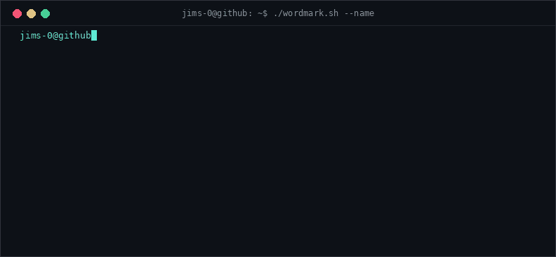

<!--
  wordmark -> assets/wordmark.gif (self-hosted, no third-party service)
  chess    -> GitSkins /api/section/chess
-->

  

  

  
  
  

## Delivery pipeline

**James Hancel "Jam" Nicolas** · Full-Stack Developer & Computer Science Student

## Operating principles

<pre><code>ROLE        = Full-Stack Developer &amp; Consultant (freelance since Jun 2025)
EDUCATION   = BS Computer Science @ Bulacan State University (BulSU)
LOCATION    = Bulacan, Philippines
FOCUS       = Designing and building software systems for real businesses</code></pre>

Building useful things and learning in public.

## Infrastructure shipped

  

### 🖥️ CleverPC POS

Point-of-sale system built for CleverPC (PC Depot), a computer hardware retail store in the Philippines. Started as a Flask web app, evolved into a delivered Windows desktop application now in post-deployment support.

- BIR-compliant receipts, VAT handling, PWD/Senior Citizen discounts
- Serial number tracking, installment logging, 7-day return policy
- Inventory management, job orders, touch mode
- 30-day trial gate and automated tests
- Packaged as a standalone Windows app

   

### 🛵 CarScoot Hub

Desktop shop-management system for a motorcycle/scooter sales and service shop, packaged as a standalone Windows app.

- Garage module: customer and bike/unit records
- Catalog: parts and bike model management
- Workshop: job check-in and job tracking
- Register: point-of-sale checkout
- Reporting: dashboard, daily sales, and commissions
- Settings: bank accounts, shop info, user management
- AI-assisted features built into the workflow

     

### 🎮 Kaizen

Gamified learning system for mathematics and coding skills. Final course output for MCS 305 (Software Engineering) at BulSU.

## Play the next move

  

## Service signals

  

## Platform toolkit

**Languages**

       

**Software & Web Development**

 

**Databases**

  

**Tools & Workflows**

   

## Certifications & achievements

**🏆 Competitions**

- **1st Place**: UP SoComSci x GDSC UP Manila's Ideathon 2023 (Team ENIGMA) · Nov–Dec 2023
- NOVUS Case Competition 2024, STEM Category: Participant (Team ENIGMA) · Apr 2024
- 8th Youth Forum on SDG Implementation, Ideas for Change Contest, UN DESA/DPIDG/UNPOG/MOIS/Incheon Metropolitan City · Sep 2024

**🎓 Workshops & Training**

- Salesforce Agentblazer Champion Workshop, Smartbridge x Salesforce Partner · Sep 2025
- BPI DATA Wave 2025 Learning Sprint, Eskwelabs
  - Module 1: Human-Centered Market Research & Ideation · Jul 2025
  - Module 2: Solution Blueprint & AI Architecture · Jul 2025
  - Module 3: Performance Evaluation & Presentation Coaching · Aug 2025
- Back to the Basics: Unlocking New Horizons with Microsoft 365, BulSU Microsoft Student Community · Apr 2025
  - Beyond the Grind: Digitizing Academic Success & Productivity with Microsoft 365
  - Beyond the Desk: Embracing Microsoft 365 for Trailblazing Professionalism
  - Beyond the Obvious: Navigating Microsoft 365 toward Redefining Collaborative Research
- Free Coding Bootcamp: Basic Web Development Workshop, BulSU Microsoft Student Community x Zuitt · Apr 2025

## Keep the story moving

I enjoy working with people who care about the details, share the context, and ship something useful.

  

  <a href="https://github.com/jims-0">GitHub</a> ·
  <a href="https://www.linkedin.com/in/james-hancel-nicolas-139123284/">LinkedIn</a>

